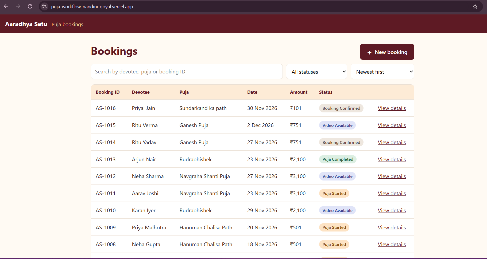
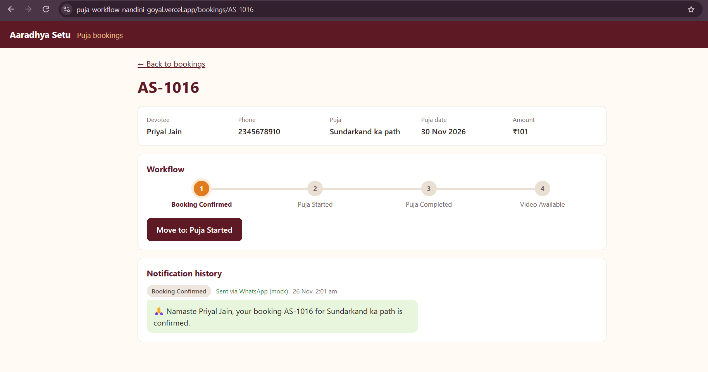
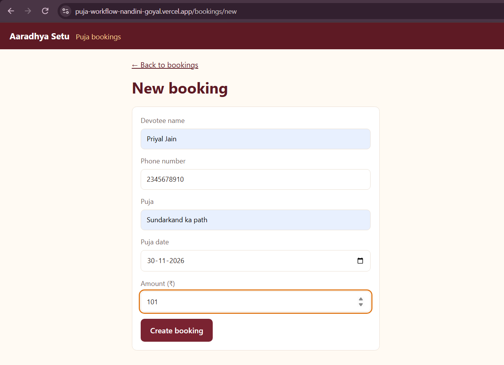
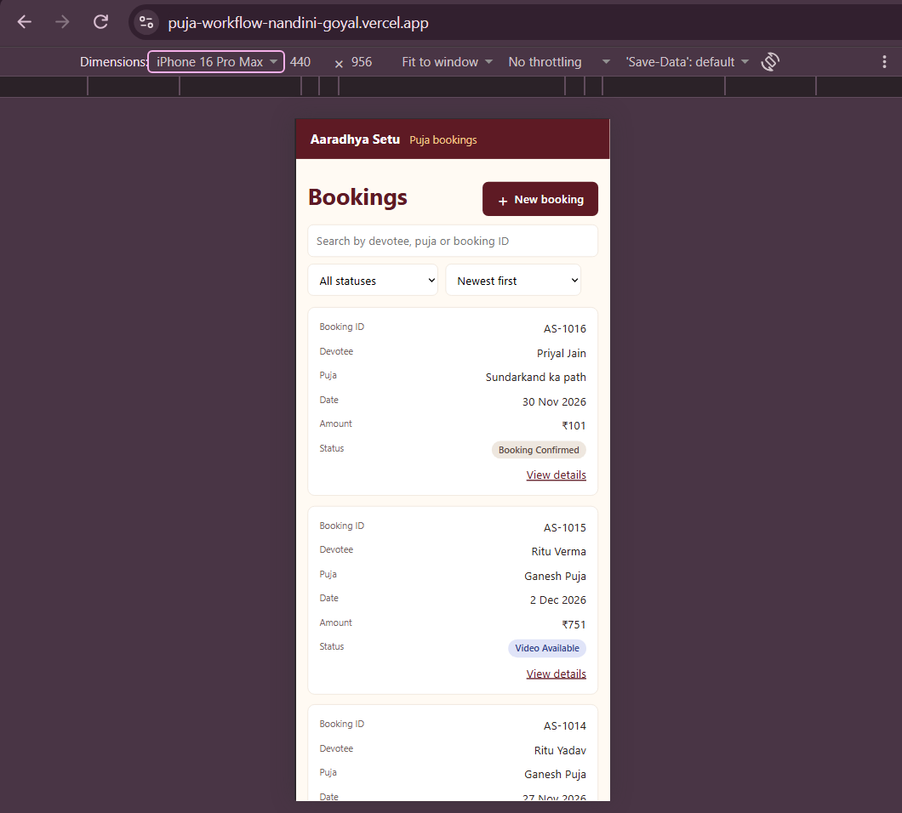

# Puja Booking Workflow & Notifications

Prototype for the Aaradhya Setu Software Engineering Intern assignment (**Option 3: Booking Workflow & Notifications**).

An admin moves a puja booking through four steps. Every step change automatically creates a templated WhatsApp notification (mocked), which is saved in the database and shown as history.

**Booking Confirmed → Puja Started → Puja Completed → Video Available**

- Live demo: https://puja-workflow-nandini-goyal.vercel.app/
- Backend API: https://booking-workflow-and-notifications.onrender.com/api/bookings
  (hosted on a free plan, so the first request may take up to a minute to wake up)

## Screenshots
| Bookings list | Booking workflow |
|---|---|
|  |  |

| New booking | Mobile view |
|---|---|
|  |  |

## Tech stack
- **Frontend:** React (Vite), react-router-dom, axios, plain CSS
- **Backend:** Node.js, Express
- **Database:** MongoDB (Mongoose)

## Features
- Bookings table with search (devotee, puja or booking ID), status filter and sorting
- Booking details page with a step tracker and notification history
- "Move to next step" button that sends the notification automatically
- "New booking" form (the starting point of the workflow)
- Notification templates with the devotee name, puja name and booking ID filled in
- WhatsApp is mocked: the message is logged on the server and saved to the database
- Responsive layout; the table turns into cards on phones

## How the workflow works
1. A booking is created with status **Booking Confirmed**, and the first notification is sent.
2. The admin clicks **Move to: <next step>**.
3. The server checks that the new status is exactly the next step. Skipping, going back or repeating returns a 400 error.
4. The status is updated, then a notification is built from the template and saved.
5. The UI reloads and shows the new status and the new notification.

## Project structure
```
server/
  constants/workflow.js          status order, message templates, helper functions
  models/                        Booking and Notification schemas
  controllers/bookingController  list, details, create, update status
  services/notificationService   builds the message, mock WhatsApp send, saves history
  routes/bookingRoutes.js        API routes
  seed.js                        random dummy data
client/src/
  pages/                         BookingList, BookingDetail, NewBooking
  components/                    StatusStepper, NotificationHistory
  api.js                         all API calls in one place
```

## API
| Method | Route | Purpose |
|---|---|---|
| GET | `/api/bookings?search=&status=&sortBy=&order=` | List bookings with search, filter, sort |
| GET | `/api/bookings/:bookingId` | One booking with its notification history |
| POST | `/api/bookings` | Create a booking (starts at Booking Confirmed) |
| PATCH | `/api/bookings/:bookingId/status` | Move to the next step and send a notification |

## Run locally
Requires Node 18+ and a MongoDB database (local or Atlas).

```bash
# Server
cd server
cp .env.example .env     
npm install
npm run seed             # random dummy data (node seed.js 30 for 30 bookings)
npm run dev              # http://localhost:5000

# Client (new terminal)
cd client
cp .env.example .env     # VITE_API_URL=http://localhost:5000/api
npm install
npm run dev              # http://localhost:5173
```